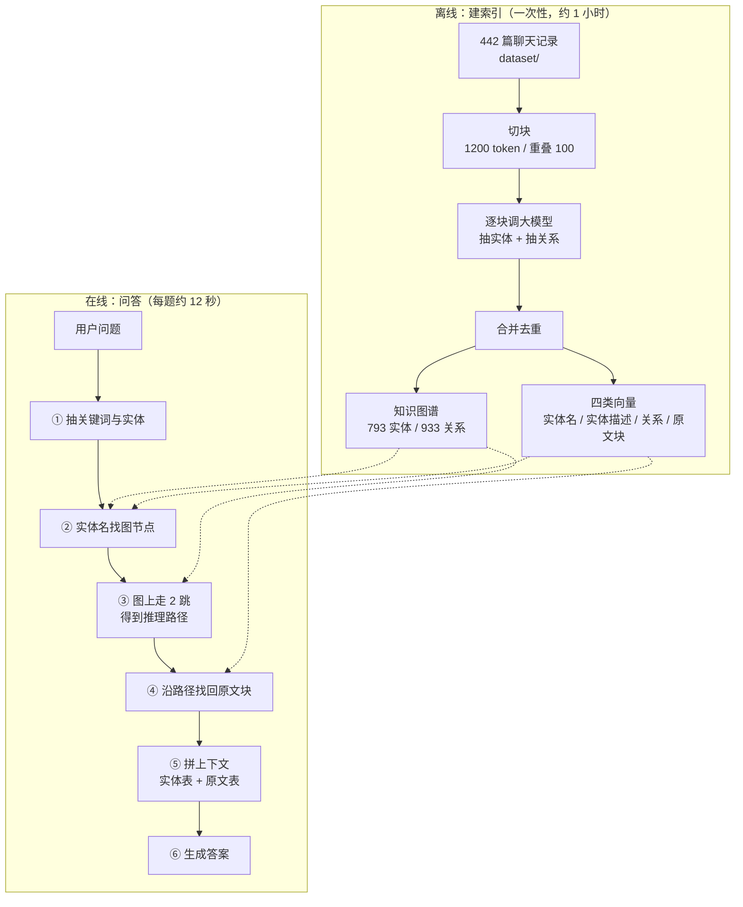
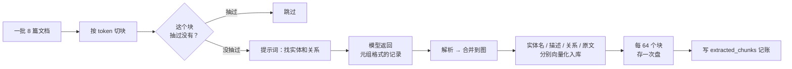
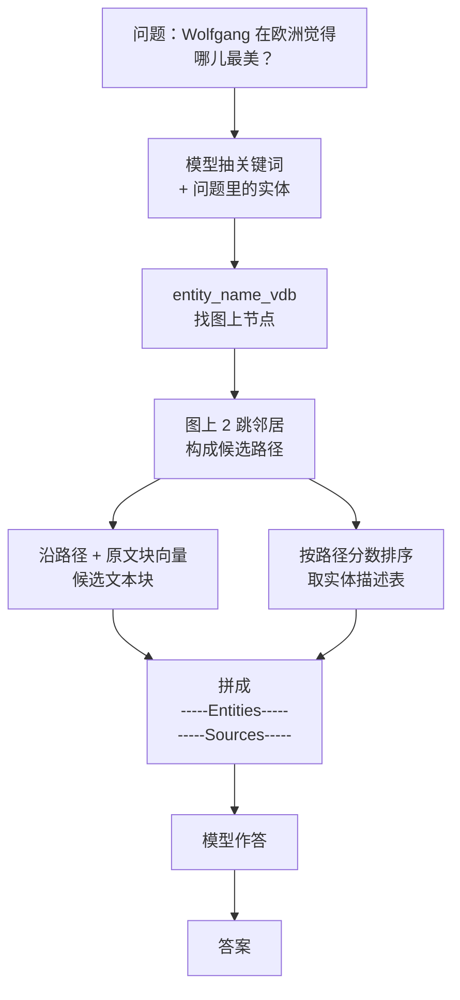
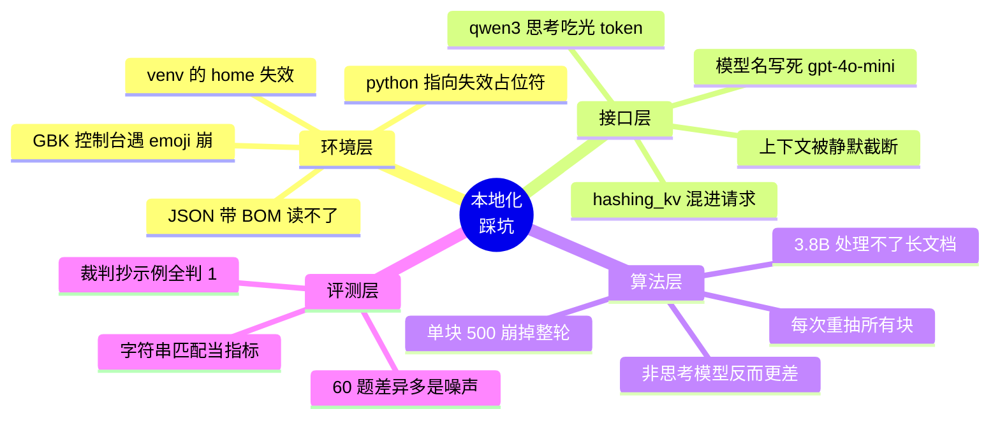
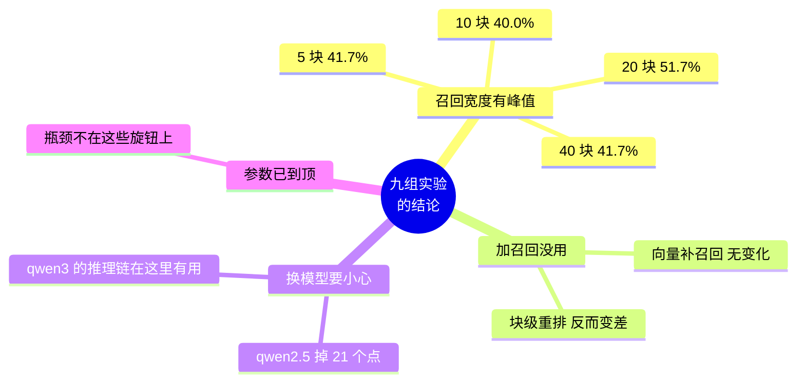

# MiniRAG 本地化改造：让它在自己的电脑上跑起来

> **这个仓库不是我原创的项目。**
> 上游是 [HKUDS/MiniRAG](https://github.com/HKUDS/MiniRAG)（MIT 协议），
> 算法、数据集、评测协议都是他们的。我做的事情只有一件：
> 把它从"依赖 OpenAI 在线接口"改成"全流程跑在本机 Ollama 上"，
> 并在 LiHua-World 上跑出一个能复现的基线，把过程中踩的坑记下来。

有 GPU 但只有 8 GB 显存、想在本机试 RAG 的，可以直接照着这个仓库走一遍。

---

## 结果

在 LiHua-World 的 637 道题上：

| 指标 | 本仓库 | 上游论文（同数据集） |
| --- | --- | --- |
| 准确率 acc | **45.84%** | 53.29%（Phi-3.5-mini）· 54.08%（gpt-4o-mini） |
| 答错率 err | 18.84% | 23.35% · 19.44% |
| 答非所问 | 35.32% | 约 23% ~ 26% |

差 7.5 个百分点，但**答错率比论文还低**
原因后面「差在哪」一节会拆开讲。

索引规模：442 篇文档 → 490 个分片 → 793 个实体 / 933 条关系，建索引耗时 56.8 分钟。

---

## 和上游的差别

| 项目 | 上游 | 本仓库 |
| --- | --- | --- |
| LLM | OpenAI `gpt-4o-mini` | 本机 Ollama `qwen3:8b` |
| embedding | `all-MiniLM-L6-v2`（384 维） | 不变，但改成离线从本地缓存加载 |
| 评测裁判 | gpt-4o / deepseek-chat | 本机 `qwen3:8b` |
| 上下文窗口 | 128k，从不截断 | 8k，需要控制上下文体积 |
| 运行方式 | `python reproduce/Step_0_index.py` | `run_index.bat` / `run_qa.bat` |

代码层面改了四个文件，其余是新增：

- `minirag/llm/openai.py` — 重写模型调用层（这是本地化最关键的一处）
- `minirag/minirag.py` — 加"已抽取分片"记账，去掉重复抽取
- `minirag/operate.py` — 回传抽取结果、加可选的块级重排
- `minirag/base.py` — `QueryParam` 新增两个实验用字段
- `reproduce/Step_0_index.py`、`reproduce/Step_1_QA.py` — 重写得更能跑、能续

---

## 系统架构



和普通 RAG 最本质的差别在检索单元：普通 RAG 拿"文本块"去比相似度，MiniRAG 拿"实体和关系"去找，再把原文当证据取回来。实体是对文本的压缩，天然更省 token，也更抗噪声——这是它敢用 3B 级小模型的原因。

## 建索引具体在做什么



## 一次查询的数据流



---

## 踩到的坑

本地化真正的难点不在算法，在于"换掉一个云端组件之后，所有隐式假设都失效了"。



挑三个最有代表性的：

**1. qwen3 的思考模式会把输出吃光**

同一个提示词，`content` 是 0 字符，`reasoning` 写了 3600 字——768 个 token 全花在思考上。在 Ollama 的 `/v1`（OpenAI 兼容）接口上，`"think": false`、提示词末尾加 `/no_think`、`chat_template_kwargs.enable_thinking=false` 三种写法**全部无效**；只有走原生接口 `/api/chat` 并带 `"think": false` 才真正关掉。

**2. 上下文是被静默截断的**

Ollama 默认窗口 4096 token，超出的部分不报错直接丢。而提示词的顺序是"角色 → 目标 → 格式 → 数据表"，被截掉的正好是证据。表现就是模型永远回"文中没有提到"。量一下才发现 system prompt 有 59189 字符（约 1.5 万 token）。

**3. 建索引是 O(n²)**

`insert()` 每次都会把**所有已处理文档的所有分片**重新抽一遍实体。第一批 60 秒，后面每批几分钟，越跑越慢。判断方法很简单：看日志时间戳，如果每批耗时单调递增，几乎一定是重复处理了历史数据。

完整的 14 个问题和排查过程在 [docs/移植与排坑记录.md](docs/移植与排坑记录.md)。

---

## 实验结果

九组配置，都在同一批 60 题（Single 30 / Multi 15 / Null 15）上跑：

| 配置 | 改动 | 答对率 | 相对基线 |
| --- | --- | --- | --- |
| **基线 top_k=20** | — | **51.7%** | — |
| top_k=40 | 召回更宽 | 41.7% | −10.0 |
| top_k=10 | 召回收窄 | 40.0% | −11.7 |
| top_k=5 | 召回更窄 | 41.7% | −10.0 |
| hybrid15 | 图路径 + 向量补召回 | 51.7% | ±0 |
| short_answer | 要求一两句话作答 | 48.3% | −3.4 |
| rerank=5 | 候选块按相似度重排 | 43.3% | −8.4 |
| rerank=8 | 同上 | 48.3% | −3.4 |
| qwen2.5:7b | 换非思考模型 | 30.0% | −21.7 |



**失分归因（637 题全量）**：

| 类型 | 题数 | 占 score=0 的比例 |
| --- | --- | --- |
| 检索返回空 | 8 | 4% |
| 模型说"没证据" | 10 | 4% |
| 答偏了 / 只答一半 | 207 | 92% |

也就是说：**不是检索不到，是检索到了但答不准。**

```
Q: Wolfgang 在欧洲觉得哪儿最美？
G: 挪威的峡湾，普罗旺斯的薰衣草田
A: 挪威的峡湾，布拉格的街道          ← 结构对，细节错
```

这类错误调 top_k 解决不了，得改检索逻辑本身。

## 差在哪

| 差异来源 | 影响 | 能不能消除 |
| --- | --- | --- |
| 裁判模型不同（gpt-4o vs qwen3:8b） | 几个百分点，方向未知 | 没有 API Key，不能 |
| 答题模型不同 | 未知 | 可以换模型验证 |
| top_k 60→20（适配 8 GB 显存） | 少看一半实体 | 硬件限制 |
| gleaning 1→0（省一半时间） | 抽取召回略降 | 可以改回去重跑 |
| 索引覆盖率 95% 而非 100% | 少量文档缺失 | 可以补齐 |

顺带一个必须说明的事实：**60 道题时，±13 个百分点以内的差异都可能是抽样波动**。上表里除了 `qwen2.5:7b`，其余差异都不能算数。

---

## 怎么跑

Windows + Ollama，8 GB 显存左右。

```powershell
# 1) 拉模型
ollama pull qwen3:8b

# 2) Python 环境（3.12；torch / transformers / openai 需要装好）
py -3.12 -m venv --system-site-packages venv_minrag

# 3) 建索引：442 篇，约 1 小时
.\run_index.bat --llm qwen3:8b --gleaning 0

# 4) 问答：637 题，约 2 小时
$env:OLLAMA_NUM_CTX = "8192"
.\run_qa.bat --topk 20

# 5) 评测（本地模型当裁判）
.\venv_minrag\Scripts\python.exe -u evaluate_local.py

# 6) 分题型统计
.\venv_minrag\Scripts\python.exe -u analyze_result.py
```

随时可以中断，重跑同一条命令会跳过已经做完的部分。

**不要用裸 `python`**：这台机器上它指向一个已被卸载的商店版占位符，会静默失败（`exit code 9009`）。用 `.bat` 或写全路径。

## 目录

```
minirag/                框架源码（4 个文件改过）
reproduce/              建索引 / 问答脚本
run_index.bat           建索引
run_qa.bat              问答
check_status.bat        看索引进度
watch_index.bat         跑完弹窗提醒
evaluate_local.py       本地评分（替代需要 OpenAI Key 的评测 notebook）
analyze_result.py       分题型统计
compare_ab.py           同题对比多个配置
make_subset.py          生成固定评测子集
draw_graph.py           图谱画成 PNG
export_for_yed_layout.py 导出 yEd 可读的 graphml
preview_yed.py          导出前先看一眼坐标
dataset/                LiHua-World 数据集（来自上游）
LiHua-World/            建好的索引 + 图谱截图 + graphml
logs/                   637 题答案与评分
docs/                   实验指导书、排坑记录、结果、实验日志
```

## 局限

- 只在一台机器上跑过（RTX 4060 Laptop 8 GB），别的显卡上耗时和显存会有出入。
- 45.84% 和论文的 53.29% 不是同口径数字，裁判模型和上下文窗口都不一样，不能直接比。
- 九个参数实验里有七个是负结果，样本量只有 60 题，结论只能当地图看，不能当定论。
- 没有做 Multi 题的时间锚点检索，这类题（66 道）目前的召回明显不够。

## 许可与致谢

- 上游项目：[HKUDS/MiniRAG](https://github.com/HKUDS/MiniRAG)，MIT 协议，本仓库沿用同一个协议（见 `LICENSE`）。
- 数据集：LiHua-World，来自上游仓库。
- 本仓库新增/修改的部分可以随意取用，但请保留上游署名。
